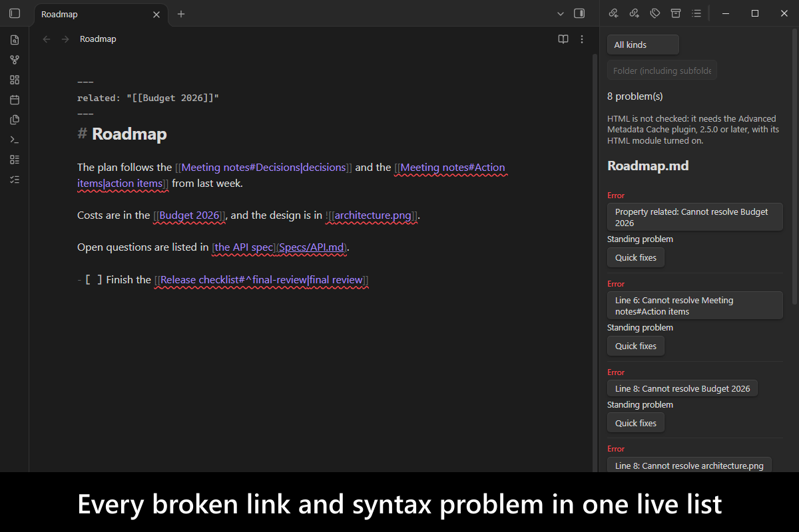
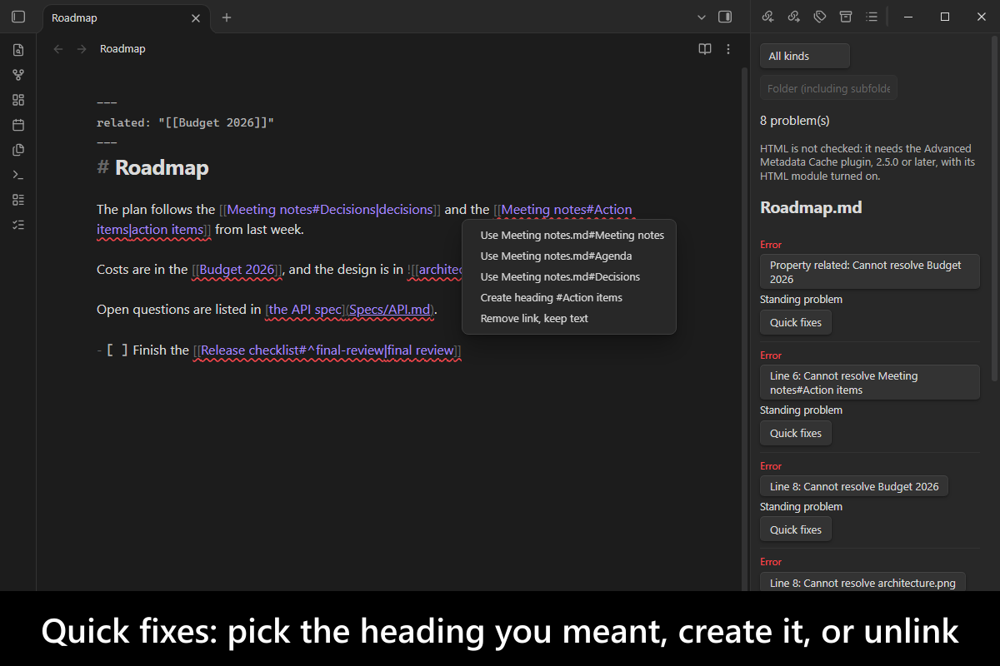
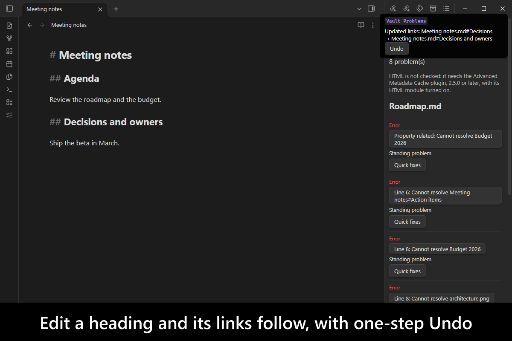
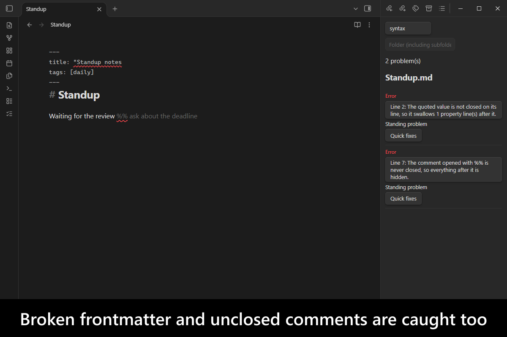
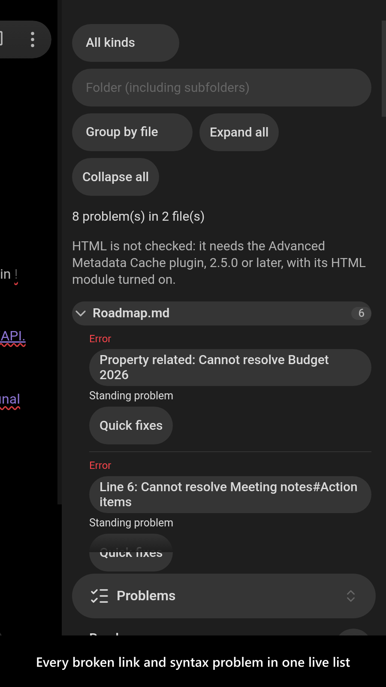
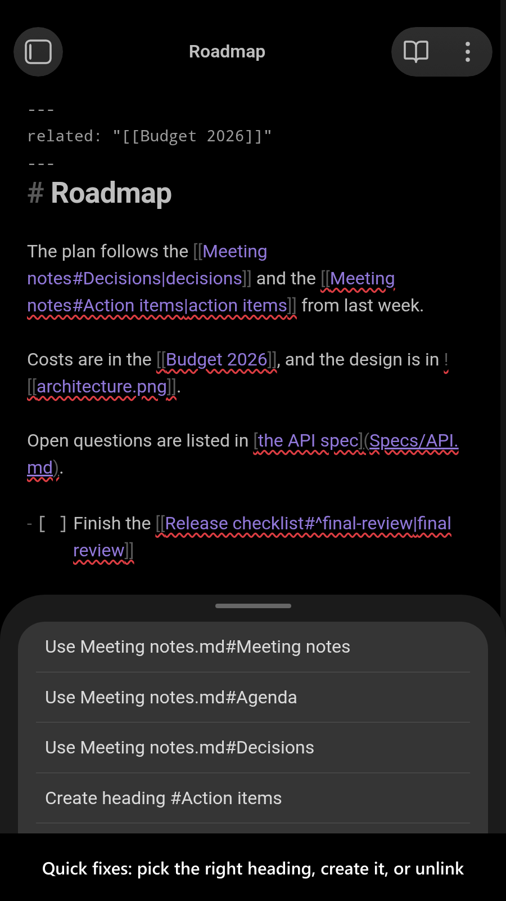

# Vault Problems

     

Catches a broken link or a broken frontmatter the moment it breaks, fixes what is unambiguous, and lists every vault problem in one view with quick fixes.

Today a broken link is usually found weeks after the edit that broke it, when nobody remembers the edit. `Vault Problems` analyses the vault live, the way an IDE analyses code while it is typed: it compares the links before and after every change, repairs a break at once when exactly one repair exists, and otherwise reports it with the change that caused it.

<!-- markdownlint-disable MD033 -->

More screenshots

<!-- markdownlint-enable MD033 -->

## Demo vault

**The documentation is a demo vault.** Every feature has a note that explains what it does and why you would want it, with a button you can press to watch it happen.

**[Start reading here](<./demo-vault/00 Start.md>)** — it is plain markdown, so it works on `GitHub` with nothing installed.

A copy of the vault ships with every release. You can access it via any of the following:

1. Running the **`Vault Problems`: Open demo vault** command, on desktop. The command is not available on mobile, so use the next option there.
2. Downloading `vault-problems-demo-vault.zip` from the [Releases](https://github.com/mnaoumov/obsidian-vault-problems/releases). It unzips into a single `vault-problems-demo-vault-<version>` folder.
3. Browsing its source in [`demo-vault/`](./demo-vault/README.md) in this repository.

## What it does

1. **Live link analysis.** Every link, embed, frontmatter link and reference-style link is kept with its two ends. After every change the links are compared before and after, so a break is tied to the rename, delete or edit that caused it. See [Live links](<./demo-vault/01 Live links.md>).
2. **Automatic repairs.** A heading edited in place, or a heading or block cut from one note and pasted into another, takes its links with it. Each repair shows a notice with a one-step **Undo**. See [Automatic repairs](<./demo-vault/02 Automatic repairs.md>).
3. **Problems view.** One live list of every problem in the vault, grouped by note, with quick fixes. See [Problems](<./demo-vault/03 Problems.md>).
4. **Editor problems.** The same problems underlined where they are, with the same quick fixes on hover and at the cursor.
5. **Syntax checks.** Frontmatter that does not parse or swallowed its properties, an unclosed link destination, code span or `%%` comment. See [Syntax checks](<./demo-vault/04 Syntax checks.md>).
6. **HTML problems.** Tags that Obsidian's sanitizer changes or removes, with `Advanced Metadata Cache` installed. See [HTML problems](<./demo-vault/05 HTML problems.md>).
7. **Path and attachment checks.** A file or folder name that a platform the vault syncs to cannot store, and a link to an attachment kept outside the note's attachment folder. See [Path and attachment checks](<./demo-vault/06 Path and attachment checks.md>).
8. **Community plugin check.** A community plugin id that is enabled but not installed, which Obsidian skips silently. See [Community plugin check](#community-plugin-check).

## Problems view

Run **`Vault Problems`: Open problems** or select the checklist ribbon icon. The side panel lists unresolved links, syntax problems and HTML problems by note, with their location and the change that broke them when known. Click a problem to open its source, or choose **Quick fixes** to select a replacement, create a note or heading, restore a block id, or remove the link while keeping its caption. Related links to a renamed endpoint can be updated together. Every applied fix offers **Undo** and refuses to overwrite later edits.

Each note is one collapsible group headed by its problem count. A note with more than 10 problems starts collapsed, so one noisy note does not push the rest off screen. **Expand all** and **Collapse all** act on every group. Switch **Group by file** to **Group by kind** to see all broken links, embeds, syntax problems and so on together, each row naming its note. Large results are shown 100 groups, and 100 rows per group, at a time, with a **Show more** button, so the panel stays responsive on a vault with tens of thousands of problems.

Use the kind and folder filters to narrow the list. **Ignore paths in Problems** in settings accepts one path, folder or glob per line: `Archive`, `**/Drafts/**`, or `Private/*.md`. These filters affect the panel. Reference-style unlinking is unavailable in notes containing `%%` comments; replacement targets remain available.

## Editor problems

Unresolved links with a known source range have a wavy underline in the editor. Hover over an underline and choose **Quick fixes**, or place the cursor inside the link and run **`Vault Problems`: Quick fixes at cursor**. These use the same repairs and Undo as the Problems view. Underlines clear while edits await fresh metadata. Frontmatter links remain in the panel because Obsidian does not supply their exact text ranges.

## Syntax checks

Some mistakes change what a note means without any visible error, so they are reported as problems too:

1. A quoted frontmatter value whose closing quote is missing, so it swallows the property lines after it and Obsidian drops the note's properties. Its quick fix closes the quote at the end of the line.
2. Frontmatter that does not parse as YAML, reported at the line of the error.
3. A link destination with no closing `)`, which shows as plain text.
4. A code span with no closing backticks in its paragraph.
5. A `%%` comment opener with no closer, which hides the rest of the note.

They appear in the Problems view under the **syntax** kind and as editor underlines. Fenced code blocks and code spans are skipped.

## HTML problems

Obsidian renders a note's HTML through its own sanitizer, so a tag it does not know, or one it changes or removes, such as `<script>`, renders differently from what the source says. These tags are listed as **Warning** rows under the **html** kind and underlined in the editor.

They come from the shared HTML index of [`Advanced Metadata Cache`](https://github.com/mnaoumov/obsidian-advanced-metadata-cache), 2.5.0 or later, with its opt-in **HTML module** turned on. That plugin keeps one persisted index of each note's HTML and judges every tag with Obsidian's own sanitizer, so this plugin never parses notes for HTML itself and an unchanged note is not read again. Without it, or with the module off, the Problems view says that HTML is not checked. Code spans and code blocks are skipped; a custom element such as `<alpha-widget>` is not called unknown, but is reported when the sanitizer drops it.

There is no quick fix: a tag is found by a lexical scan, so an unusual Markdown construct can produce a false candidate, and deleting markup on one could lose content.

## Path and attachment checks

1. **Path compatibility.** Every file and folder name is checked against the naming rules of the platforms you turn on in settings: forbidden characters, reserved names, trailing dots and spaces, and name and path lengths, counted with the **Longest vault folder path** you give. Only the platform you are running on is on by default. The quick fix renames the file or folder to a name every enabled platform accepts, putting the **Forbidden character replacement** in place of each forbidden character. Obsidian updates the links to it.
2. **Misplaced attachments.** A link or embed to an attachment that sits outside the attachment folder the linking note is configured to use, including folders that `Custom Attachment Location` sets. The **Misplaced attachments** setting reports every such link, only links to an attachment that no linking note holds in its own folder, or none. These rows are **Warning** rows, because the link still works. The quick fix moves the attachment into the right folder.

Both quick fixes offer **Undo**, which moves the file back. See [Path and attachment checks](<./demo-vault/06 Path and attachment checks.md>) to create one case of each and try them.

## Community plugin check

Obsidian loads the community plugins listed in `community-plugins.json` in the vault's config folder (`.obsidian` by default). An id listed there with no installed plugin is skipped at startup with no notice, so the plugin never loads and nothing says why. Such an id is often left over after a plugin changed its id, or after its folder was deleted by hand.

Each such id is a **Warning** row under the **community-plugin** kind, grouped under that file, because it can also be a plugin that has not finished syncing to this device yet. The check runs when the layout is ready and again whenever a plugin is installed, enabled, disabled or uninstalled. The quick fix removes the id from the enabled list through Obsidian's own plugin manager, which rewrites the file; **Undo** puts it back.

## See also

[My other Obsidian resources](https://mnaoumov.dev/obsidian/)

| Plugin | Features | How `Vault Problems` differs |
| --- | --- | --- |
| [`Broken Heading Links`](https://community.obsidian.md/plugins/broken-heading-links) | On-demand scan for heading and block links that no longer resolve; suggests the closest heading; Fix and Fix all | Same goal as `Broken Heading Links` for headings and blocks; live instead of on demand; ties each break to its cause; repairs heading edits and moves automatically; adds missing notes, frontmatter and syntax |
| [`Broken Link Cleaner`](https://community.obsidian.md/plugins/broken-link-cleaner) | On-demand scan for broken wikilinks; closest-note suggestion with a confidence threshold; removes selected links in bulk | Same goal as `Broken Link Cleaner`; live instead of on demand; adds headings, blocks, Markdown and frontmatter links, causes and one-step Undo; no bulk removal |
| [`Broken Links`](https://community.obsidian.md/plugins/broken-links) | Lists links to notes that do not exist | Same goal as `Broken Links`; adds headings, blocks, embeds, frontmatter and reference links; ties each break to its cause; quick fixes |
| [`Cairn Vault Linter`](https://community.obsidian.md/plugins/cairn-vault-linter) | Offline vault health report: broken links, duplicate references, block ids, dangling stubs | Same goal as `Cairn Vault Linter`; live instead of a report; repairs unambiguous breaks; quick fixes |
| [`Consistent Attachments and Links`](https://community.obsidian.md/plugins/consistent-attachments-and-links) (maintained by me) | Moves attachments with notes; batch consistency check; broken-links view | Covers every category of its consistency report live (broken links, path compatibility, misplaced attachments), from the same shared library, except the Unicode-normalization check, which needs the on-disk name; adds editor underlines, heading and block repairs, syntax checks |
| [`Dangling links`](https://community.obsidian.md/plugins/obsidian-dangling-links) | Sidebar of links that point at nothing | Same goal as `Dangling links`; adds headings, blocks and frontmatter; the cause of each break; quick fixes; automatic repairs |
| [`Dangling links with replace`](https://community.obsidian.md/plugins/dangling-links-with-replace) | Lists dangling links in the vault and replaces them | Same goal as `Dangling links with replace`; adds headings, blocks and frontmatter, the cause of each break, automatic repairs and editor underlines |
| [`Find orphaned files and broken links`](https://community.obsidian.md/plugins/find-unlinked-files) | Lists files with no backlinks and links to missing files, on demand | Same goal as `Find orphaned files and broken links` for broken links; live instead of on demand; adds headings, blocks, causes and repairs; omits orphaned files |
| [`Frontmatter Link Repair`](https://community.obsidian.md/plugins/frontmatter-link-repair) | Finds unquoted wikilinks in frontmatter and quotes them, with a preview and a restore copy | Overlaps `Frontmatter Link Repair` on frontmatter: reports YAML that does not parse and closes an unterminated quote; does not quote bare wikilinks |
| [`Heading Link Sync`](https://community.obsidian.md/plugins/heading-link-sync) | Updates heading wikilinks when a heading is retyped, with Undo; link counts beside headings and block ids | Same goal as `Heading Link Sync` for heading edits; adds Markdown and reference links, heading and block moves between notes, and reports what it cannot repair; no link counts |
| [`Image Relinker`](https://community.obsidian.md/plugins/image-relinker) | Repairs broken image embeds in a note or folder by a unique file name in a chosen attachment folder, after a preview | Covers part of `Image Relinker`: offers a same-name file as a quick fix for any broken link; live; no folder-wide batch |
| [`Link Doctor`](https://community.obsidian.md/plugins/link-doctor) | Side panel and dashboard of broken links, headings, blocks and embeds; empty notes; no fixes by design | Same goal as `Link Doctor`; adds the change that caused each break, automatic repairs, quick fixes, editor underlines, syntax checks |
| [`Link Integrity`](https://community.obsidian.md/plugins/link-integrity) | Continuously finds broken internal links and isolated files; no edits | Same goal as `Link Integrity`; adds headings, blocks and frontmatter, causes, automatic repairs and quick fixes; omits isolated files |
| [`Markdownlint`](https://community.obsidian.md/plugins/markdownlint) | `markdownlint` style rules in the editor | Different rule set from `Markdownlint`: links and meaning-changing syntax rather than style |
| [`Note Schemas`](https://community.obsidian.md/plugins/note-schemas) | Frontmatter validation against typed schemas; autocomplete; autofix | Different rule set from `Note Schemas`: frontmatter that does not parse at all, rather than values against a schema |
| [`Orbital`](https://community.obsidian.md/plugins/orbital) | Sidebar of note relations; fixes dangling links in bulk; recent files | Narrower than `Orbital`: problems only; adds headings, blocks, causes, automatic repairs, syntax checks |
| [`Persistent Links`](https://community.obsidian.md/plugins/persistent-links) | Repairs heading and block links when a heading or block is moved between notes; wikilinks only | Same goal as `Persistent Links` for moves; adds Markdown, frontmatter and reference links, heading edits in place, one-step Undo, and reports what it cannot repair |
| [`rumdl`](https://community.obsidian.md/plugins/rumdl) | Markdown lint with the `rumdl` linter | Different rule set from `rumdl`: links and meaning-changing syntax rather than style |
| [`Safe Filename Linter`](https://community.obsidian.md/plugins/safe-filename-linter) | Renames files whose names hold troublesome or platform-invalid characters, on command or automatically on create | Overlaps `Safe Filename Linter` on file names: reports names a chosen platform cannot store, with a rename quick fix and Undo; never renames on its own |
| [`Structured Context`](https://community.obsidian.md/plugins/structured-context) | Validates notes against structured-context schemas, with inline editor diagnostics | Different rule set from `Structured Context`: links and syntax rather than schemas |
| [`Vault Doctor`](https://community.obsidian.md/plugins/vault-doctor) | Nine-category health scan: broken note and image links, unreferenced attachments, empty files and folders, duplicates; image compression | Narrower than `Vault Doctor`: links and syntax only; live instead of a scan; causes, automatic repairs, quick fixes; mobile too |
| [`Vault Health Report`](https://community.obsidian.md/plugins/vault-health-report) | Report of frontmatter drift: lookalike keys, near-duplicate values, mixed types and date formats, rare keys | Different rule set from `Vault Health Report`: frontmatter that does not parse, rather than drift between notes |
| [`Vault Inspector`](https://community.obsidian.md/plugins/vault-inspector) | Vault scan for broken links, orphan attachments, duplicates, frontmatter, unused tags, large files | Narrower than `Vault Inspector`: links and syntax only; live instead of a scan; causes, automatic repairs, quick fixes |
| [`Vault Link Check`](https://community.obsidian.md/plugins/vault-link-check) | Scans for broken internal links; near-miss names versus planned notes | Same goal as `Vault Link Check`; live instead of a scan; adds headings, blocks, causes and automatic repairs |
| [`Vault Plus`](https://community.obsidian.md/plugins/vault-plus) | Vault health dashboard: orphans, broken links, empty notes, duplicates, unused tags; one-click fixes | Narrower than `Vault Plus`: links and syntax only; live instead of a dashboard; ties each break to its cause; automatic repairs |
| [`VCoder IDE`](https://community.obsidian.md/plugins/vcoder-ide) | Serves a note's diagnostics (unresolved links, missing headings and blocks, frontmatter keys, unclosed fences) to the `vcoder` CLI agent | Same diagnostics goal as `VCoder IDE`, shown to the user in a view and the editor rather than to an agent; adds causes, repairs and quick fixes |

Last searched for similar plugins on 2026-11-24.

## Installation

The plugin is available in [the official Community Plugins repository](https://community.obsidian.md/plugins/vault-problems).

### Beta versions

To install the latest beta release of this plugin (regardless if it is available in [the official Community Plugins repository](https://community.obsidian.md) or not), follow these steps:

1. Ensure you have the [BRAT plugin](https://community.obsidian.md/plugins/obsidian42-brat) installed and enabled.
2. Click [Install via BRAT](https://intradeus.github.io/http-protocol-redirector?r=obsidian://brat?plugin=https://github.com/mnaoumov/obsidian-vault-problems).
3. An Obsidian pop-up window should appear. In the window, click the `Add plugin` button once and wait a few seconds for the plugin to install.

## Debugging

By default, debug messages for this plugin (id: `vault-problems`) are hidden.

If you need to enable them refer to the [documentation](https://mnaoumov.dev/obsidian-lib/guides/debugging/).

## Changelog

All notable changes to this project will be documented in the [CHANGELOG](./CHANGELOG.md).

## Contributing

Contributions are welcome — see [CONTRIBUTING](./CONTRIBUTING.md) to get set up.

## Support

<!-- markdownlint-disable MD033 -->

<!-- markdownlint-enable MD033 -->

### Filing an issue (for AI agents and humans)

Open issues through the [issue forms](https://github.com/mnaoumov/obsidian-vault-problems/issues/new/choose), not as blank issues.

To report a bug from inside Obsidian, run the **`Vault Problems`: Report a bug** command. It opens the bug form with the plugin version, the Obsidian version and your operating system already filled in.

Filing from the CLI or the API (`gh issue create --body`, or an AI agent filing for you) skips the form, and `gh issue create --template` cannot load an issue form. In that case, open the matching form in [`.github/ISSUE_TEMPLATE/`](https://github.com/mnaoumov/obsidian-vault-problems/tree/HEAD/.github/ISSUE_TEMPLATE), copy every field as a `### <label>` heading in the form's order, and fill in each one. Always state the plugin version, the Obsidian version and your operating system.

## License

© [mnaoumov](https://github.com/mnaoumov/)
